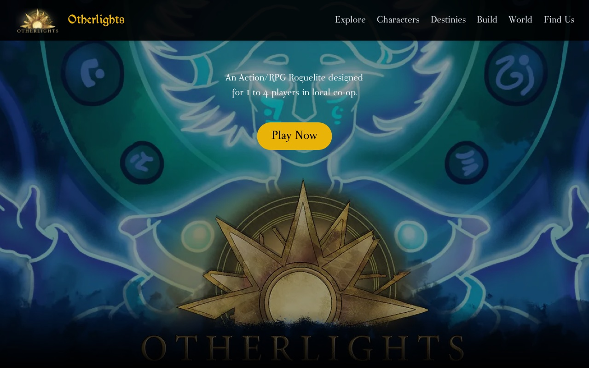

# Otherlights — official website

Source of the official website for **Otherlights**, an action/RPG roguelite
designed for 1 to 4 players in local co-op.

**Live site:** <https://www.otherlights.fr/>



## Sections

The single-page site is split into components under `src/app/components/`:

- `Hero` — title, trailer link and call to action
- `Explore`, `Characters`, `Destinies`, `Build`, `World` — game presentation
- `Find Us` — store and social links
- `Footer`

## Stack

- [Next.js 15](https://nextjs.org/) with the App Router
- React 19 release candidate, TypeScript
- Tailwind CSS 3
- Self-hosted fonts (`src/app/fonts/`)

## Run locally

Requires Node.js 20+.

```bash
npm ci
npm run dev        # http://localhost:3000
```

Production build:

```bash
npm run build
npm run start
```

`npm run lint` runs the Next.js ESLint configuration.

Only `package-lock.json` is used by these commands. `pnpm-lock.yaml` is kept
from an earlier install and is not the reference lockfile.

## Deployment

The site is deployed on Vercel from the `main` branch.

## Assets and license

The **source code** is released under the [MIT license](LICENSE).

Game artwork, logos, screenshots, the store capsule and the bundled fonts are
**excluded from the MIT license** and remain the property of their respective
owners, all rights reserved. They may not be reused outside this website. See
[ASSETS.md](ASSETS.md) for the exact scope.
